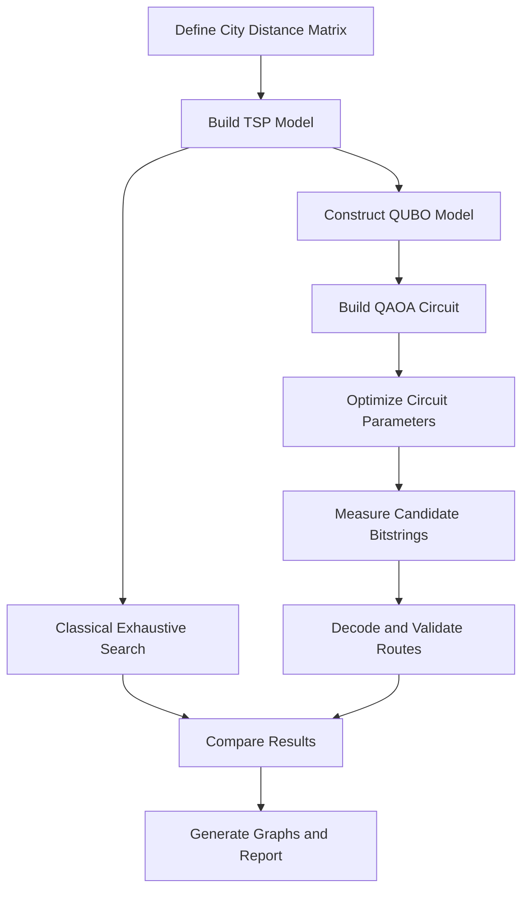
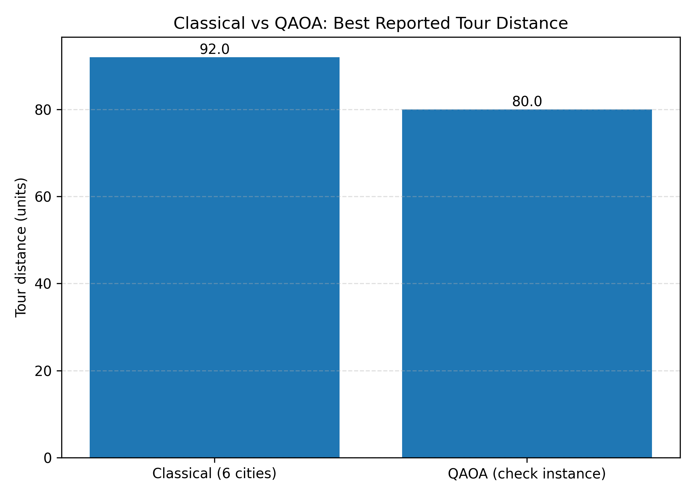
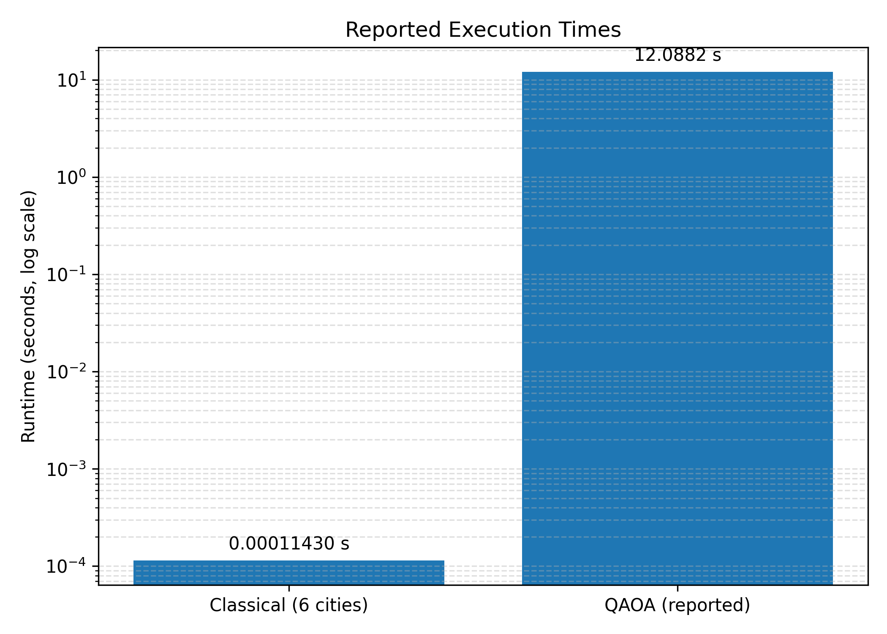
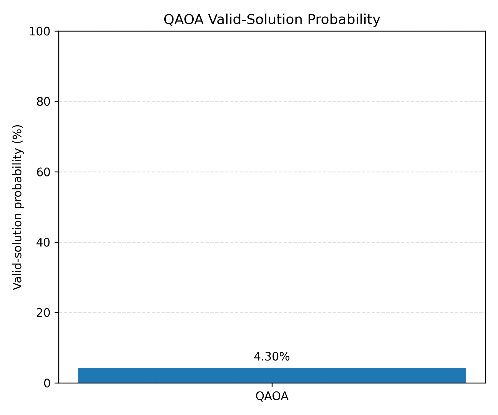
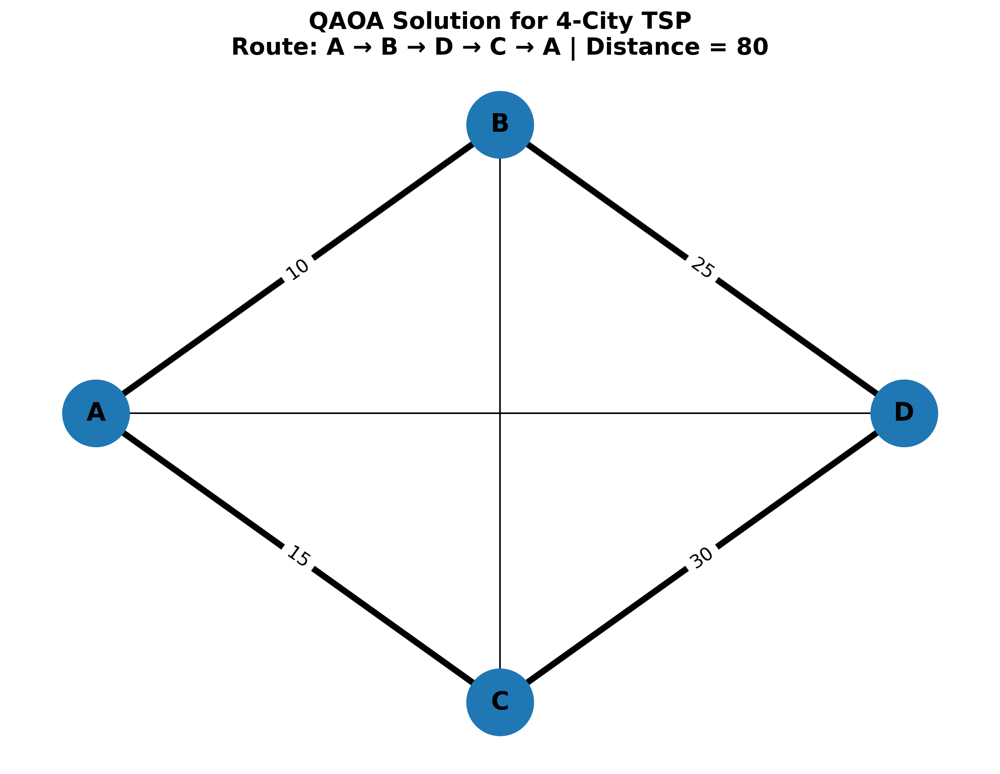

# ⚛️ QAOA vs Classical Algorithms for the Travelling Salesperson Problem

<p align="center">
  
</p>

<p align="center">
  
  
  
  
  
</p>

<p align="center">
  <b>Bridging Classical Optimization and Quantum Computing</b>
</p>

---

## 📌 About the Project

The Travelling Salesperson Problem (TSP) is a combinatorial optimization problem in which a salesperson must visit every city exactly once and return to the starting city while minimizing the total travel distance.

This project explores two approaches:

- **Classical Exhaustive Search:** evaluates every possible tour to find the optimal solution for small instances.
- **Quantum Approximate Optimization Algorithm (QAOA):** formulates the problem as a binary optimization model and explores candidate solutions using a parameterized quantum circuit simulation.

The objective is to understand their formulations, solution quality, computational costs, and challenges in quantum optimization.

## 🎯 Objectives

- Implement a classical TSP solver using Python.
- Formulate TSP constraints using a Quadratic Unconstrained Binary Optimization (QUBO) model.
- Simulate a QAOA-based optimization workflow.
- Decode candidate bitstrings into routes.
- Visualize routes and compare experimental metrics.
- Identify limitations in solution validity, circuit simulation, and parameter optimization.

## 🧠 Algorithms

### 1. Classical Exhaustive Search

The classical solver fixes the starting city, generates permutations of the remaining cities, and evaluates each complete tour.

For a symmetric TSP with \(n\) cities, fixing the starting city gives \((n-1)!\) possible tours to evaluate.

**Advantage:** guarantees the optimum when every tour is evaluated correctly.

**Limitation:** factorial growth makes exhaustive search impractical for larger instances.

### 2. Quantum Approximate Optimization Algorithm (QAOA)

QAOA uses a cost Hamiltonian and a mixing Hamiltonian to prepare candidate solutions. Its parameters are adjusted to seek lower-cost solutions.

For TSP, binary decision variables can represent whether a city occupies a particular position in the tour. Penalty terms enforce constraints such as visiting each city once and assigning one city to each position.

**Potential benefit:** provides a framework for investigating quantum optimization.

**Current limitation:** a simulation does not establish a quantum speedup, and low constraint satisfaction or low valid-route probability can reduce practical solution quality.

## 🔄 Project Workflow



## 📂 Repository Structure

```text
QAOA-TSP-Classical-Comparison/
│
├── app.py
├── classical_tsp.py
├── classical_tsp_4city.py
├── compare_graphs.py
├── decode_qaoa.py
├── qaoa_optimized.py
├── qaoa_simulation.py
├── qaoa_solver.py
├── qubo_model.py
├── verify_qubo.py
├── route_visualization.py
│
├── graph1_distance.png
├── graph2_runtime.png
├── graph3_valid_probability.png
├── qaoa_best_route.png
│
├── qubo_matrix.npy
├── qaoa_optimization_results.npy
│
├── README.md
├── requirements.txt
└── LICENSE
```

*The structure above is the intended organization; add `requirements.txt`, `README.md`, and `LICENSE` if they are not yet present.*

## 📊 Experimental Visualizations

### Distance comparison



### Runtime comparison



### Valid-solution probability



### Best QAOA route visualization



> **Important:** These figures are preliminary. The existing six-city classical run and four-city QAOA run use different problem instances. Do not interpret their distances as a fair direct comparison. Regenerate the comparison using the same city matrix, constraints, and evaluation conditions before reporting final performance.

## 🛠️ Technologies

- Python
- NumPy
- Matplotlib
- QUBO optimization modelling
- Quantum circuit simulation and QAOA
- Git and GitHub

Use the actual dependencies and quantum framework imported by your scripts when completing `requirements.txt`.

## 🚀 Getting Started

### 1. Clone the repository

```bash
git clone https://github.com/YOUR-USERNAME/QAOA-TSP-Classical-Comparison.git
cd QAOA-TSP-Classical-Comparison
```

Replace `YOUR-USERNAME` with your GitHub username.

### 2. Create a virtual environment (recommended)

```bash
python -m venv .venv
```

On Windows PowerShell:

```powershell
.\.venv\Scripts\Activate.ps1
```

### 3. Install dependencies

After creating a valid `requirements.txt`, run:

```bash
python -m pip install -r requirements.txt
```

### 4. Run the classical solver

```bash
python classical_tsp.py
```

For the four-city instance, if that script is ready:

```bash
python classical_tsp_4city.py
```

### 5. Run the QAOA experiment

```bash
python qaoa_optimized.py
```

Other scripts may depend on saved `.npy` files or on outputs from earlier steps. Follow their requirements and inspect the source before running them independently.

## 📈 Evaluation Metrics

The project considers:

| Metric | Purpose |
|---|---|
| Best tour distance | Measures route quality |
| Execution time | Measures elapsed computation time |
| Valid-solution probability | Measures how often measurements produce feasible solutions |
| QUBO energy | Evaluates a bitstring under the encoded objective and penalties |
| Route validity | Checks city uniqueness and return to the starting city |

Runtime comparisons should use the same machine and clearly state what each timing includes. Classical and simulated quantum runtime measurements are not directly equivalent unless their evaluation procedures are defined consistently.

## 🔬 Current Research Status

This repository is an experimental prototype intended for learning and research.

- Classical exhaustive search can provide a verified optimum for small instances.
- QAOA results depend on the QUBO encoding, circuit construction, parameter search, and measurement sampling.
- The current four-city and six-city results must be separated in any final analysis.
- Reported preliminary metrics should be reproduced and validated before being used in an IEEE paper.
- No quantum advantage is claimed.

## 🔮 Future Improvements

- Use a shared distance matrix for all methods.
- Improve constraint handling and decoding of invalid routes.
- Compare QAOA with classical heuristics such as nearest neighbour and simulated annealing.
- Evaluate multiple parameter initializations and random seeds.
- Report mean and variability across repeated runs.
- Add automated tests and reproducible experiment configuration.
- Explore noise-aware simulation and error mitigation where supported by the implementation.

## 👩‍💻 Author and Contributions

Developed as an educational and research project exploring combinatorial optimization and quantum computing.

**Author:** YOUR NAME  
**Institution:** YOUR INSTITUTION  
**Research Area:** Quantum Computing · Optimization · Algorithms

## 📜 License

Choose a license before adding a `LICENSE` file. The MIT License is one common option for projects intended to permit reuse with attribution.

---

<p align="center">
  <i>Learning, experimenting, and exploring the future of optimization.</i>
</p>
